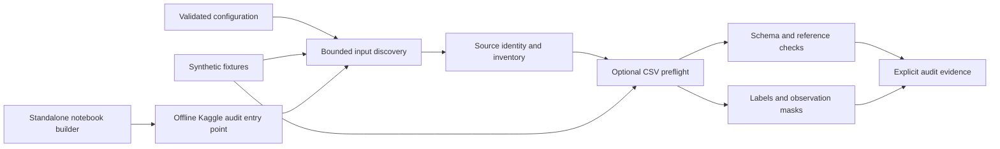
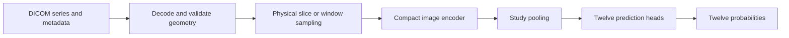
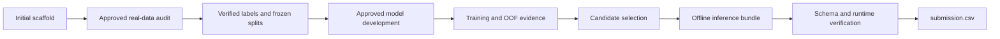

# RSNA Knee Abnormality Detection

An experimental MRI project for sparse-label learning and reproducible Kaggle inference.

## Project status

**Initial scaffold.** The project provides validated configuration, bounded input discovery, explicit data and label contracts, synthetic checks, and a self-contained Kaggle audit notebook. Competition access, dataset contents, decoding feasibility, and gold-resource provenance remain unverified. No model has been trained, no pretrained weights have been adopted, and no performance results are available.

This rebuild is on `rebuild/clean-slate`. Historical working-tree deletions remain part of the rebuild; the previous implementation has not been restored. The verified recovery backup is `D:\RSNA_backup_before_reset_20261012_104506`. GitHub `main` remains unchanged.

This project is **not clinically validated** and is not intended for diagnosis or clinical decisions.

## Start locally

Use Python 3.10 or later from the repository root. The scaffold uses the Python standard library. Synthetic checks need no package installation, competition files, Kaggle credentials, GPU, or internet access.

```powershell
python scripts/check_scaffold.py
python scripts/audit.py --config configs/audit.json
python scripts/build_audit_notebook.py
```

The audit defaults to discovery only. Missing local competition files produce an explicit incomplete result and nonzero exit status. Results are written to unique JSON files under `artifacts/`. A valid synthetic check or notebook does not establish that competition inputs passed an audit.

Review [data contracts](docs/data_contract.md) and [Kaggle execution](docs/kaggle.md) before using attached inputs. Real-data analysis, model development, and external assets require further approval.

The [initial scaffold review](docs/scaffold_review.md) records the actual local validation: 80 tests passed and one native symlink test was skipped. This is software evidence on synthetic fixtures; it is not a dataset or model result.

## Architecture

The implemented scaffold establishes auditable boundaries for later experiments.



The later image-model architecture remains a proposal, conditional on real-data and validation gates.



## Workflow and approval gates



Only the initial scaffold is implemented. No real-data analysis, validation splits, image decoding, models, checkpoints, or submission inference have been produced. The submission validator checks a supplied probability table; it does not generate predictions.

## Repository guide

| Location | Purpose |
|---|---|
| `src/rsna_knee/` | Configuration, discovery, contracts, preflight, metric and submission checks |
| `configs/audit.json` | Conservative discovery configuration |
| `scripts/` | Local checks, preflight entry point, deterministic notebook generation |
| `tests/` | Small synthetic fixtures and regression checks |
| `notebooks/kaggle_audit.ipynb` | Generated notebook with cleared execution state |
| [Architecture](docs/architecture.md) | Module boundaries and future gates |
| [Data contract](docs/data_contract.md) | Identifiers, labels, paths, source identity, and coverage |
| [Validation protocol](docs/validation_protocol.md) | Undefined metrics and leakage protections |
| [Kaggle workflow](docs/kaggle.md) | Browser execution of the self-contained notebook |
| [Asset registry](docs/asset_registry.md) | External-asset status and approval requirements |

Keep datasets, DICOMs, credentials, environment secrets, caches, checkpoints, virtual environments, and large artifacts out of Git. Source inputs remain immutable. Review compact evidence before retaining it deliberately.

## Results

No dataset measurements or model metrics have been established. These target names form the planned contract and must be compared with the actual competition CSVs.

| Target | Validation positives / negatives | ROC AUC |
|---|---|---|
| ACL | Not measured | — |
| MCL | Not measured | — |
| Medial Meniscus | Not measured | — |
| Lateral Meniscus | Not measured | — |
| Medial OA | Not measured | — |
| Lateral OA | Not measured | — |
| PF OA | Not measured | — |
| Effusion | Not measured | — |
| Synovitis | Not measured | — |
| Baker's | Not measured | — |
| Contusion | Not measured | — |
| Fracture | Not measured | — |
| **Macro across all twelve** | **Not measured** | **Not measured** |

## Current limitations

- Account access, rules acceptance, attached inputs, and current execution restrictions are unverified.
- Synthetic checks cannot establish real dataset integrity, label quality, DICOM compatibility, or clinical validity.
- Input scans are bounded. Missing inputs, ambiguous roots, unsafe paths, and incomplete coverage must stay visible.
- The separate gold resource remains **GOLD_RESOURCE_NOT_LOCATED**. An expected study count is not evidence of its existence.
- Patient identity, target support, report quality, storage, runtime, and GPU budget require real measurements.
- The notebook defaults to discovery. Training, downloads, network requests, and pretrained assets are outside this phase.

## References and provenance

The competition is [RSNA Knee Abnormality Detection](https://www.kaggle.com/competitions/rsna-knee-abnormality-detection). Check its [data page](https://www.kaggle.com/competitions/rsna-knee-abnormality-detection/data) and [evaluation page](https://www.kaggle.com/competitions/rsna-knee-abnormality-detection/overview/evaluation) in an authenticated browser before relying on live rules or access.

The Mermaid diagrams were written for this rebuild. No external visual assets, datasets, teachers, or pretrained weights are included. A repository code license has not been selected; competition data and any future external assets retain separate usage terms.
