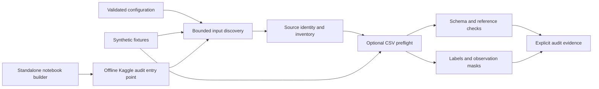
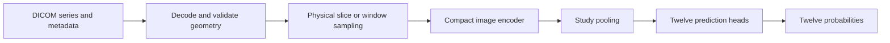
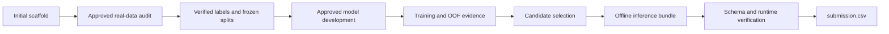
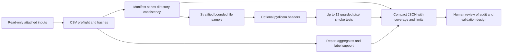

# RSNA Knee Abnormality Detection

An experimental MRI project for sparse-label learning and reproducible Kaggle inference.

## Project status

**Reviewed Phase B audit implementation, awaiting Kaggle evidence.** The project provides validated configuration, CSV and label contracts, bounded series-directory discovery, sampled DICOM headers and decoding smoke tests, report-quality aggregates, validation-support diagnostics, and self-contained offline audit notebooks. No model has been trained, no pretrained weights have been adopted, and no performance results are available.

The scaffold and corrected preflight notebooks were merged at `2f7ff41`. The reviewed Phase B implementation is maintained separately on `phase-b/dicom-audit`. The historical recovery backup is `D:\RSNA_backup_before_reset_20261012_104506`.

The user confirmed a successful Kaggle CSV audit with Internet disabled and no accelerator: 4,407 training studies, 24,371 training series, and 3 visible test studies with 15 series. All five manifests were read, all training reports were nonempty, and no CSV study/series overlap was reported. Each target had 58 observed labels (both classes) and 4,349 unknown labels. These are user-supplied runtime observations, not local remeasurements; the three visible test studies are not the complete hidden evaluation set. Actual DICOM compatibility, report quality, patient mapping, and gold provenance remain unverified.

This project is **not clinically validated** and is not intended for diagnosis or clinical decisions.

## Start locally

Use Python 3.10 or later from the repository root. The scaffold uses the Python standard library. Synthetic checks need no package installation, competition files, Kaggle credentials, GPU, or internet access.

```powershell
python scripts/check_scaffold.py
python scripts/audit.py --config configs/audit.json
python scripts/build_audit_notebook.py
python scripts/build_audit_notebook.py --inspect-csv --output notebooks/kaggle_audit_csv.ipynb
python scripts/build_phase_b_notebook.py
```

The audit defaults to discovery only. Missing local competition files produce an explicit incomplete result and nonzero exit status. Results are written to unique JSON files under `artifacts/`. A valid synthetic check or notebook does not establish that competition inputs passed an audit.

Review [data contracts](docs/data_contract.md), [Kaggle execution](docs/kaggle.md), and the [Phase B audit scope](docs/phase_b_audit.md) before using attached inputs. Phase B is an approved read-only audit; validation design, models, training, weak labels, and external assets require separate review.

The [initial scaffold review](docs/scaffold_review.md) records the actual local validation: 80 tests passed and one native symlink test was skipped. This is software evidence on synthetic fixtures; it is not a dataset or model result.

## Architecture

The implemented scaffold establishes auditable boundaries for later experiments.



The later image-model architecture remains a proposal, conditional on real-data and validation gates.



## Workflow and approval gates



The scaffold and Phase B audit software are implemented. Local synthetic tests do not establish actual DICOM support. No approved validation split, model, checkpoint, or submission inference has been produced. The submission validator checks a supplied probability table; it does not generate predictions.



## Repository guide

| Location | Purpose |
|---|---|
| `src/rsna_knee/` | Configuration, discovery, contracts, Phase B audit, metric and submission checks |
| `configs/audit.json` | Conservative discovery configuration |
| `scripts/` | Local checks, preflight entry point, deterministic notebook generation |
| `tests/` | Small synthetic fixtures and regression checks |
| `notebooks/kaggle_audit.ipynb` | Generated notebook with cleared execution state |
| `notebooks/kaggle_audit_csv.ipynb` | Generated CSV preflight notebook |
| `notebooks/kaggle_phase_b_audit.ipynb` | Generated read-only series, report, DICOM and validation audit |
| [Architecture](docs/architecture.md) | Module boundaries and future gates |
| [Data contract](docs/data_contract.md) | Identifiers, labels, paths, source identity, and coverage |
| [Validation protocol](docs/validation_protocol.md) | Undefined metrics and leakage protections |
| [Kaggle workflow](docs/kaggle.md) | Browser execution of the self-contained notebook |
| [Asset registry](docs/asset_registry.md) | External-asset status and approval requirements |

Keep datasets, DICOMs, credentials, environment secrets, caches, checkpoints, virtual environments, and large artifacts out of Git. Source inputs remain immutable. Review compact evidence before retaining it deliberately.

## Results

The Kaggle CSV observations above establish sparse support, not a reliable validation estimate. Per-class support will be recomputed by Phase B from the verified CSV contracts. No validation metrics or model metrics have been measured.

| Target | Validation positives / negatives | ROC AUC |
|---|---|---|
| ACL | Not measured | — |
| MCL | Not measured | — |
| Medial Meniscus | Not measured | — |
| Lateral Meniscus | Not measured | — |
| Medial OA | Not measured | — |
| Lateral OA | Not measured | — |
| PF OA | Not measured | — |
| Effusion | Not measured | — |
| Synovitis | Not measured | — |
| Baker's | Not measured | — |
| Contusion | Not measured | — |
| Fracture | Not measured | — |
| **Macro across all twelve** | **Not measured** | **Not measured** |

## Current limitations

- The supplied CSV evidence describes one Kaggle runtime; current DICOM and codec compatibility still need that runtime's Phase B output.
- Synthetic checks cannot establish real dataset integrity, label quality, DICOM compatibility, or clinical validity.
- Input scans are bounded. Missing inputs, ambiguous roots, unsafe paths, and incomplete coverage must stay visible.
- The separate gold resource remains **GOLD_RESOURCE_NOT_LOCATED**. An expected study count is not evidence of its existence.
- Patient identity, per-class validation support, report quality and DICOM metadata need real Phase B evidence. Sampling cannot establish full dataset integrity or a trustworthy dataset-wide patient map.
- The original notebook defaults to discovery; the new Phase B notebook enables CSV checks and bounded image smoke tests. Training, downloads, network requests and pretrained assets are outside this phase.

## References and provenance

The competition is [RSNA Knee Abnormality Detection](https://www.kaggle.com/competitions/rsna-knee-abnormality-detection). Check its [data page](https://www.kaggle.com/competitions/rsna-knee-abnormality-detection/data) and [evaluation page](https://www.kaggle.com/competitions/rsna-knee-abnormality-detection/overview/evaluation) in an authenticated browser before relying on live rules or access.

The Mermaid diagrams were written for this rebuild. No external visual assets, datasets, teachers, or pretrained weights are included. A repository code license has not been selected; competition data and any future external assets retain separate usage terms.
