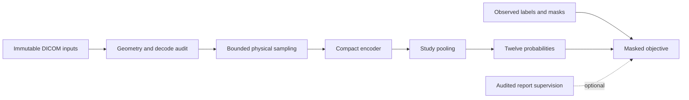

# Architecture

## Current scope

The scaffold and Phase B modules provide bounded discovery, CSV preflight, series topology checks, report/label diagnostics and sampled DICOM evidence. Synthetic development uses standard-library tooling and is independent of Kaggle authentication and competition data. Real DICOM inspection uses only an already installed pydicom; absence remains blocked.

Phase B is approved for a read-only audit. Actual Kaggle DICOM evidence is pending; validation design, weak supervision and model development require separate review.

| Responsibility | Contract |
|---|---|
| Configuration | Reject invalid types, unknown options, and unsafe or unbounded limits |
| Discovery | Identify missing, partial, ambiguous, unsafe, or incomplete inputs explicitly |
| Data contracts | Preserve identifiers, schema expectations, references, and label uncertainty |
| CSV preflight | Inspect permitted CSVs only when requested; state counts and coverage |
| Series inventory | Learn manifest-backed directory conventions; expose limits, ambiguity and namespace scope |
| DICOM sampling | Bound stratified file/header/decode samples; no caches or full-coverage claims |
| Report quality | Aggregate text/script indicators without emitting text or deriving labels |
| Validation support | Retain observation masks; distinguish necessary marginal support from joint feasibility |
| Metrics | Calculate masked binary AUC; expose undefined targets and unavailable full macro |
| Submission checks | Validate supplied identifiers, exact columns, finite probabilities, and range |
| Notebook builder | Embed source deterministically into a self-contained, output-free notebook |
| Synthetic tests | Exercise boundary conditions without external files or services |

## Boundaries

The original AuditConfig defaults to discovery only; original preflight reports remain `INITIAL_SCAFFOLD` with Phase B `NOT_RUN`. The separate PhaseBConfig requires CSV inspection and validates image-audit budgets. Phase B reports use `rsna-knee-phase-b-v1` and explicit check statuses. Both report types keep training readiness false; valid manifests and sampled image checks do not authorize training.

Source inputs remain immutable. Output belongs in a separate directory. Path checks reject a location that escapes its declared root, including symbolic links or junctions. Scan limits are evidence of incomplete coverage, never a reason to declare an unmeasured check complete.

The builder embeds the source required for the audit entry point and records SHA-256 identity. The notebook does not clone a repository, install packages, call APIs, authenticate the Kaggle CLI, or retrieve weights.

The dedicated Phase B builder shares the source bundler, idempotent checksum loader and protected output writer with the original builder. It adds a separate private package namespace and six-cell order; the two original five-cell notebooks and their configuration modes remain unchanged. See [Phase B scope](phase_b_audit.md) for budgets and coverage.

## Proposed future model

This model path is not implemented. Simple pooling and masked BCE are proposed baseline choices. Physical sampling, 2D versus 2.5D representation, resolution, series selection, and encoder choice depend on measured data and compute constraints. Strong and weak supervision would use separate masks and provenance, with observed reference labels taking precedence.

## Implementation gates

1. Confirm live competition rules, access, and inputs.
2. Approve and run the schema, label, report, and DICOM audit.
3. Establish reliable grouping and target support; freeze validation definitions.
4. Approve model development and any external assets.
5. Profile a baseline before setting training and inference budgets.

Add future modules when these gates require them. Empty model, training, and inference placeholders are not part of this scaffold.
