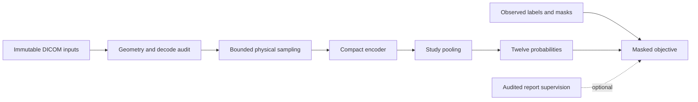

# Architecture

## Current scope

This scaffold provides the boundaries needed for bounded discovery and an auditable preflight. It uses ordinary Python files and standard-library tooling. Synthetic development is independent of Kaggle authentication and competition data.

The rebuild follows the approved plan. Historical source and reports remain deleted. Real-data analysis, image processing, and model development require further approval.

| Responsibility | Contract |
|---|---|
| Configuration | Reject invalid types, unknown options, and unsafe or unbounded limits |
| Discovery | Identify missing, partial, ambiguous, unsafe, or incomplete inputs explicitly |
| Data contracts | Preserve identifiers, schema expectations, references, and label uncertainty |
| CSV preflight | Inspect permitted CSVs only when requested; state counts and coverage |
| Metrics | Calculate masked binary AUC; expose undefined targets and unavailable full macro |
| Submission checks | Validate supplied identifiers, exact columns, finite probabilities, and range |
| Notebook builder | Embed source deterministically into a self-contained, output-free notebook |
| Synthetic tests | Exercise boundary conditions without external files or services |

## Boundaries

Configuration defaults to discovery only. CSV inspection is an explicit option. A report always identifies its phase as `INITIAL_SCAFFOLD`, its Phase B status as `NOT_RUN`, and training readiness as false; valid manifests do not authorize training.

Source inputs remain immutable. Output belongs in a separate directory. Path checks reject a location that escapes its declared root, including symbolic links or junctions. Scan limits are evidence of incomplete coverage, never a reason to declare an unmeasured check complete.

The builder embeds the source required for the audit entry point and records SHA-256 identity. The notebook does not clone a repository, install packages, call APIs, authenticate the Kaggle CLI, or retrieve weights.

## Proposed future model

This model path is not implemented. Simple pooling and masked BCE are proposed baseline choices. Physical sampling, 2D versus 2.5D representation, resolution, series selection, and encoder choice depend on measured data and compute constraints. Strong and weak supervision would use separate masks and provenance, with observed reference labels taking precedence.

## Implementation gates

1. Confirm live competition rules, access, and inputs.
2. Approve and run the schema, label, report, and DICOM audit.
3. Establish reliable grouping and target support; freeze validation definitions.
4. Approve model development and any external assets.
5. Profile a baseline before setting training and inference budgets.

Add future modules when these gates require them. Empty model, training, and inference placeholders are not part of this scaffold.
