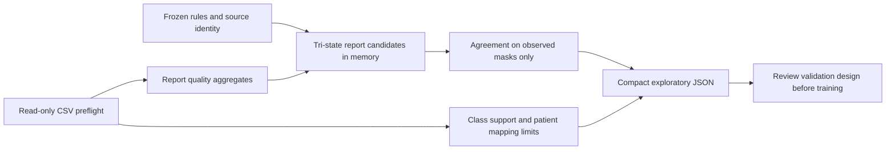

# Phase C: frozen report supervision and validation design

## Evidence and current scope

This reviewed implementation is awaiting a Kaggle report-agreement run. The user reports successful CSV and bounded DICOM audits: 4,407 nonempty training reports, 24,371 training series/directories, 58 observed-label studies, 696 observed cells, 52,188 unknown cells, 15 visible test-series directories, and 128/128 headers plus 12/12 pixel smoke tests successful. No raw Kaggle audit artifact is included or locally remeasured here. Three visible test studies are only that notebook runtime's sample. Full DICOM integrity, independent gold provenance and dataset-wide patient grouping remain unverified.

Phase C creates research candidates, not gold annotations or model predictions. It never changes CSVs or observed targets, reads DICOM headers/pixels, trains, creates checkpoints, calls APIs or downloads packages. Local fixtures are synthetic. Real agreement metrics are pending; successful tests cannot establish competition accuracy.

## Frozen baseline and coverage

The initial rule version is `rsna-report-rules-v1.0.0`, with engine policy `conservative-english-clause-v1`. `freeze_rules()` returns an immutable rule set before extraction and agreement. Its canonical SHA-256 covers all target definitions, cue patterns, normalization and scope policies; `verify()` checks that identity before and after extraction. The notebook separately records the actual engine source hash and bundle hash. Configuration limits are recorded too, so the evaluated baseline is reproducible.

Frozen canonical rule SHA-256: `6b99524064346b0c9380f8b1f51dc693637d5bf7b0af4b536bc3e054c61b623a`.

Rules were developed using synthetic examples only. Do not change them in response to agreement on all 58 observed-label studies and call the resulting agreement independent validation. After inspecting agreement, any rule change is development: use a new version/hash and an independently reviewed outer holdout or nested design. The initial evaluation is explicitly EXPLORATORY.

| Target | Conservative evidence vocabulary |
|---|---|
| ACL | Explicit ACL/anterior cruciate abnormality or explicit absence/intact finding |
| MCL | Separate medial collateral abnormality/absence vocabulary |
| Medial / lateral meniscus | Explicit named side and meniscal abnormality or intact/absence finding |
| Medial / lateral / PF OA | Explicit OA/osteoarthritis/degenerative joint evidence with named compartment |
| Effusion / synovitis | Explicit current assertion/qualified finding or explicit scoped absence |
| Baker's | Explicit Baker/popliteal cyst finding or absence |
| Contusion | Explicit bone/marrow contusion evidence; ambiguous or wrong-tissue mentions abstain |
| Fracture | Explicit current fracture finding or scoped absence |

Rules normalize Unicode NFKC, case and whitespace, then inspect bounded clauses and target-specific contexts. A target name alone, an unmentioned target, equivocal/differential wording, historical/indication text, unsupported language/script cues and conflicting assertions remain UNKNOWN. No absent-term negative inference occurs. Negation is scoped to evidence, not simply any nearby "no". See synthetic regressions for exact supported phrases; this narrow prototype cannot reliably interpret every report construction or competition target definition.

This is an English baseline. Latin characters do not prove English; Devanagari does not prove Hindi. Unicode/script indicators and a few language-rejection cues are heuristics, not language detection. Unsupported or mixed script is conservatively unclassified. Synonyms, transliteration, clinical shorthand, complex discourse, anatomic variants and noisy translations may reduce coverage or cause errors. Candidate reliability needs actual aggregate evidence and future clinical review; no claim of reliable multilingual extraction is made.

## Agreement denominators and uncertainty

For each target, output includes candidate positive/negative/unknown/conflict counts, overall candidate coverage, observed positive/negative support, unknown truth counts, abstentions by truth class, classified-observed coverage and TP/FP/TN/FN. Unknown reference cells never enter confusion counts; UNKNOWN candidates never become negatives or FN/TN. Every proportion stores numerator, denominator, value and nominal 95% Wilson interval; undefined proportions and intervals are null.

| Metric | Denominator and scope |
|---|---|
| Candidate coverage | Candidate positive + negative / all reports |
| Observed-truth coverage | Classified observed cells / all observed cells |
| Selective agreement | (TP + TN) / classified observed cells |
| PPV | TP / (TP + FP), observed cells only |
| Selective sensitivity | TP / (TP + FN), classified observed positives only |
| Selective specificity | TN / (TN + FP), classified observed negatives only |
| NPV | TN / (TN + FN), observed cells only |
| Detection sensitivity | TP / all observed positives; abstentions are undetected, not negative labels |

High selective agreement with low coverage may be unhelpful. Read class distribution and abstentions alongside each metric; no undenominated ordinary accuracy is reported. A denominator or class support below 10 triggers explicit warnings; that threshold is only a warning policy, not a guarantee of reliability above it. Wilson intervals are nominal binomial intervals: correlated patients, nonrepresentative label selection, multiple comparisons and the small 58-study set can invalidate optimistic interpretations. Candidate agreement is not MRI-model performance, independent validation or a final competition score.

## Patient grouping and validation feasibility

Phase C reuses verified target counts and unchanged label masks. It checks necessary positive/negative support for two and three study-grouped folds and preserves the existing bounded tiny joint-coverage diagnostic. Marginal support is not sufficient for a simultaneous twelve-target split. Exact search is limited to 12 labeled studies for two folds or 8 for three; the real 58-study joint problem remains NOT_ASSESSED by that search. No split assignments are emitted or approved.

The audit investigates recognized candidate patient columns in train/study-series CSVs using only counts and within-study consistency. Their presence is not proof of trustworthy provenance or complete mapping. The prior 128 DICOM headers were a sample; they cannot establish dataset-wide patient independence. No new DICOM reads are performed. Patient-grouped validation remains NOT_ASSESSED until an authoritative, complete, consistent mapping and provenance are established. Repeated-study grouping can reduce independent per-class support and invalidate an apparently feasible study split.

Review a small two-fold study/patient-grouped exploratory design before choosing more folds. Assess observed class coverage, joint feasibility, patient leakage, selection bias and interval width; meaningful twelve-target conclusions may be impossible. Sparse labels may prevent a reliable twelve-target validation estimate. `split_approved=false` and `training_ready=false` are retained even if all scoped audit checks pass. There is no independently proven 58-study gold resource.

## Future image-training design (proposal only)

Maintain separate per-study/per-target records for OBSERVED, REPORT_CANDIDATE and UNKNOWN supervision. Preserve exact original target order, identifiers, values and observation masks. Observed targets take precedence. For previously unknown training-partition cells, future approved candidates may supply separate weak targets/masks, rule hashes, provenance and reviewed weights; they never overwrite reference columns. UNKNOWN contributes no fabricated negative loss. Weights, consistency losses and eligibility thresholds require future review, not Phase C training code.

1. Establish trustworthy study/patient grouping and review/freeze outer membership before experiments. Keep all series/slices of each study together and all verified repeated-patient studies together.
2. Within each outer training partition, fit any weak-label generation, transformations, vocabulary, learned preprocessing and calibration. Generate training candidates only from training-partition reports. Treat automatic labels as weak evidence.
3. Exclude outer validation-study reports and their derived candidates from model training, rule tuning, vocabulary fitting and preprocessing. Validation uses original observed targets and masks only.
4. Use inner development for rules, candidate thresholds, weights and model selection. Do not describe inner selection scores or exploratory all-58 agreement as a final estimate. Lock an independent reference holdout or reviewed nested outer evaluation for final evidence.
5. Keep test studies and hidden targets out of all selection decisions. Preserve sample-submission membership/columns exactly. The eventual competition model consumes MRI series at inference and must not require report text because test reports are unavailable.
6. Record fold/source/rule identities and each reference-set reuse. Patient uncertainty, low class support or unreliable candidate quality may require deferring training altogether.

## Kaggle import and execution

Run `python scripts/build_phase_c_notebook.py` locally. For different budgets, use `--config` with a validated project JSON and explicit Kaggle input/output paths, then regenerate the whole notebook. No manual notebook-cell additions are needed.

1. Import the entire `notebooks/kaggle_phase_c_report_audit.ipynb` into a fresh Kaggle notebook.
2. Attach only the official competition input. Select CPU/no accelerator and Internet Off.
3. Save and Run All from a clean session. Six cells: introduction, verified embedded source, one validated configuration, CSV preflight, ordered Phase C pipeline, aggregate report write.
4. Review check statuses, rule identity, actual denominators, confidence intervals, abstentions, coverage and limitations. Do not publish raw reports, IDs or per-study candidate tables; the notebook emits only aggregate JSON.
5. Retain `/kaggle/working/rsna_audit/phase_c_<UTC>_<suffix>.json` and return the compact evidence for review. Do not revise rules on all observed labels and silently rerun as independent validation.

Defaults: 32 MiB per CSV, 100,000 rows per manifest, 20,000 characters and 256 clauses per report, 120 seconds of cooperative extraction, and 1 MiB JSON. Smaller per-report limits produce explicit UNKNOWN abstentions, never partial-prefix classifications. Exhausted extraction time blocks agreement instead of silently evaluating a partial subset. JSON size is checked before printing and writing. All five CSV hashes are verified before/after. No report text, snippets, identifiers, per-study predictions, pixels or large arrays are included in output.

The original two CSV notebooks keep their false/true inspection modes; Phase B remains an image audit. Phase C embeds only the needed standard-library audit sources and no DICOM module. Generated notebooks have empty outputs/counts. Local isolated execution is software evidence; actual Kaggle agreement remains pending.

## Local validation record (2026-10-12)

- Full standard-library runner: 226 tests run, 224 passed, 2 skipped, no failures.
- Full pytest suite: 224 passed, 2 skipped, 364 subtests passed.
- Phase C tests: 59 passed, 232 subtests passed, no skips. Extraction tests alone: 16 passed, 127 subtests covering all twelve tri-states and reviewed scope, anatomy, uncertainty, history, conflict, Unicode, malformed inputs, budgets, privacy and frozen identity.
- Existing skips are unavailable native Windows symlink creation and the optional real synthetic pydicom roundtrip because pydicom is absent. Nothing was installed.
- All four notebooks passed nbformat validation, module/bundle checksums, deterministic in-memory rebuild and repeated CLI generation. Their cell counts / CSV modes remain 5/false, 5/true, 6/true and 6/true.
- All four actual stored notebooks executed in fresh `python -I -B` processes with network sockets forbidden and only synthetic deployment paths overridden after configuration. Input hashes, report roundtrips and output privacy passed. Phase C completed with PASS, imported no pydicom/DICOM module, decoded no pixels and retained both readiness flags false. Phase B correctly reported FAIL because the CSV-only fixture lacks three referenced training-series directories and one test-series directory: selected series, empty series and selected files are all zero. The expected diagnostic was verified and execution continued to Phase C. A focused regression now records this distinction; no production behavior or fixture was changed.
- Existing artifacts were refreshed with unchanged builders after merge-checkout line-ending differences. Phase B's embedded byte hashes now match the current checkout; its behavior/configuration remain unchanged. No original source or label contract was modified.
- nbclient/ipykernel are absent locally, so isolated Python execution was used rather than a live Jupyter kernel. Real rule agreement, patient mapping and Kaggle-runtime compatibility remain pending.

| Notebook | Bytes | SHA-256 |
|---|---:|---|
| `kaggle_audit.ipynb` | 60,174 | `35cb85fa8dc71f339dfe117cefc7e0a9731c01020f706b057439f02dbaba1dba` |
| `kaggle_audit_csv.ipynb` | 60,173 | `38398ad4562b01f43a9b98bbc884b278f12804fa3c04b5d0f703f557eaae8362` |
| `kaggle_phase_b_audit.ipynb` | 169,797 | `f2c45a6094fecb69d4038073c6f2754dfffdfdae46475601002396e6bab984c8` |
| `kaggle_phase_c_report_audit.ipynb` | 144,410 | `cd44a5984b5b87ebdf339bbdb128aee88b4c847c18245f9c32525f58b2773a58` |
